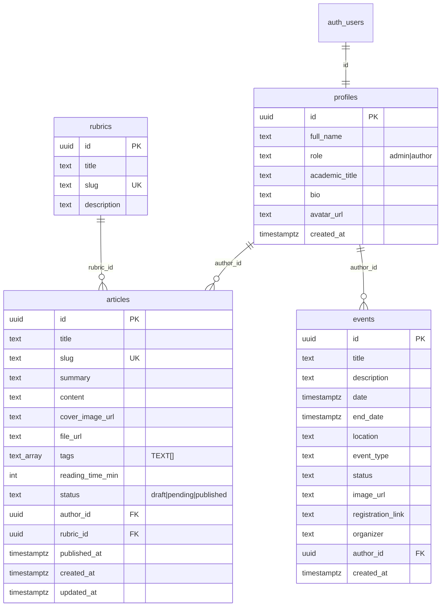

# Crescendo

Академична и професионална уеб платформа за **музикално образование** — статии по рубрики, учебни PDF ресурси, медия, календар със събития и публична търсачка.

Стек: **Vanilla JS + Bootstrap 5 + Vite (MPA)** и **Supabase** (PostgreSQL, Auth, Storage, RLS).

---

## 1. Project Description

### Какво прави платформата

Crescendo публикува редакционно съдържание и практически материали за музикални педагози, изследователи и образователни лидери:

| Възможност | Описание |
|------------|----------|
| **Статии по рубрики** | Публикации в петте рубрики: Ползи, Политики, Практики, El Sistema, Резонанс |
| **Учебни PDF/ZIP ресурси** | Незадължителен файл към статия (`file_url`) — ноти, работни листове; качване в Storage bucket `lesson-resources` |
| **Медия (корици)** | Водещи изображения към статии в bucket `article-covers` (`cover_image_url`) |
| **Събития** | Календар: концерти, конференции, покани за доклади (`events`) |
| **Търсачка** | Частично, case-insensitive търсене (`ilike`) в заглавие, резюме, съдържание и рубрики; съвпадения и в масива `articles.tags` |
| **Тагове** | Масив от текст (`TEXT[]`) директно в `articles` — баджове, филтър с `contains` / `tags=cs.{tag}` |
| **Редакторски панел** | Автори и администратори създават/редактират статии; само админ публикува |

> Статичните текстове на публичните страници са в HTML; динамичните данни идват от Supabase чрез Vanilla JS.

### Роли и права

| Действие | Guest (анонимен) | Author (authenticated) | Admin |
|----------|:----------------:|:----------------------:|:-----:|
| Четене на публикувани статии и събития | ✅ | ✅ | ✅ |
| Търсене / филтър по таг | ✅ | ✅ | ✅ |
| Изтегляне на PDF ресурс (`file_url`) | ✅ | ✅ | ✅ |
| Вход в панела (`/dashboard.html`) | ❌ | ✅ | ✅ |
| Създаване / редакция на **собствени** статии (`draft`, `pending`) | ❌ | ✅ | ✅ |
| Качване на корица / PDF в Storage (собствена папка `{user_id}/…`) | ❌ | ✅ | ✅ |
| Публикуване (`status = published`) / сваляне | ❌ | ❌ | ✅ |
| Редакция / изтриване на **чужди** статии | ❌ | ❌ | ✅ |
| Добавяне на събития | ❌ | ограничено* | ✅ |

\*Автори могат да създават събития според RLS; пълното управление е за администратори.

**Статуси на статия:** `draft` → `pending` (за преглед) → `published` (само админ).

### Създаване на автори (само от администратор)

Платформата **няма публична регистрация**. Авторите не се самозаписват през сайта — акаунтите се създават ръчно от администратор в Supabase.

| Стъпка | Къде | Какво се задава |
|--------|------|-----------------|
| 1. Акаунт за вход | Supabase → **Authentication → Users** → *Add user* | **Имейл** и **парола** на автора (тези данни ползва при `/login.html`) |
| 2. Профил | Таблица `public.profiles` (редът се създава автоматично при signup/trigger към `auth.users`) | `full_name`, по желание `academic_title`, `bio`, `avatar_url` |
| 3. Роля | `profiles.role` | `'author'` (по подразбиране) или `'admin'` за администратор |

**Работен поток:**

1. Администраторът създава потребител в **Authentication → Users** с имейл и временна парола.
2. При създаването на `auth.users` trigger-ът `handle_new_user` добавя ред в `profiles` (обикновено с `role = 'author'`).
3. Администраторът (или чрез SQL Editor) попълва/коригира `full_name` и при нужда сменя `role` на `'admin'`.
4. Авторът влиза само през `/login.html` с предоставените имейл и парола и работи в `/dashboard.html`.

> Паролите се съхраняват в **Supabase Auth** (`auth.users`), не в `profiles`. В `profiles` са само публичните/редакционните данни и ролята.

---

## 2. Architecture & Tech Stack

### Frontend

- **HTML5** — Multi-Page Application (MPA): всяка страница е отделен `.html` файл
- **CSS3** — Bootstrap 5 + бранд overrides в `src/styles/main.css` (CSS custom properties)
- **Bootstrap 5** + **Bootstrap Icons**
- **Vanilla JavaScript (ES6+ modules)** — без React/Vue/TypeScript
- **Vite** — dev server, bundling, MPA `rollupOptions.input`

### Backend & BaaS (Supabase)

- **PostgreSQL** — таблици, индекси, triggers
- **Supabase Auth** — email/password, JWT (anon key + user access token)
- **Supabase Storage** — публични buckets за изображения и PDF/ZIP
- **Row Level Security (RLS)** — правата се прилагат в базата, не само във фронтенда

### Архитектура (Jamstack / BaaS)

```
┌─────────────────────────────────────────────────────────────────┐
│                        Browser (MPA)                            │
│  index.html · benefits.html · article.html · dashboard.html …   │
│         │                                                       │
│         ▼                                                       │
│  Vite / static assets                                           │
│  src/main.js → router → pages / components / services           │
└─────────────┬───────────────────────────────┬───────────────────┘
              │ REST + Auth JWT               │ Storage API
              ▼                               ▼
┌─────────────────────────────┐   ┌───────────────────────────────┐
│     Supabase (BaaS)         │   │     Supabase Storage          │
│  • Auth (JWT)               │   │  • article-covers (images)    │
│  • PostgreSQL + RLS         │   │  • lesson-resources (PDF/ZIP) │
│  • profiles, rubrics,       │   │  Path: {user_id}/file.ext     │
│    articles (tags TEXT[]),  │   └───────────────────────────────┘
│    events                   │
└─────────────────────────────┘
```

Поток на данни: статичният UI се зарежда от Vite; услугите в `src/services/` викат Supabase REST/JS клиента. Публичните четения ползват anon key; записите от панела — JWT на логнатия потребител.

---

## 3. Database Schema Design

### Mermaid ERD



> Таговете **не** са отделни таблици. Колоната `articles.tags` е `TEXT[]` (напр. `{'ноти','피아노','5 клас'}`). Филтър при клик: PostgREST `tags=cs.{tag}` ≡ `.contains('tags', [tag])`.

**Storage (не е SQL таблица в `public`, а Supabase Storage):**

| Bucket | Публичен | Лимит | MIME | Връзка в DB |
|--------|----------|-------|------|-------------|
| `article-covers` | да | 5 MB | JPEG, PNG, WebP, GIF | `articles.cover_image_url` |
| `lesson-resources` | да | 20 MB | PDF, ZIP | `articles.file_url` |

Обектите се качват като `{auth.uid()}/{timestamp}-{random}.{ext}` — RLS позволява upload само в собствената папка.

### SQL: таблици и ключови RLS политики

Пълният източник на истина са миграциите в `supabase/migrations/`. По-долу е **обобщен** скрипт (схемата след всички миграции). За нова среда предпочитай да приложиш файловете по ред.

```sql
-- Extensions
create extension if not exists "pgcrypto";

-- Profiles (1:1 с auth.users)
create table public.profiles (
  id uuid primary key references auth.users (id) on delete cascade,
  full_name text,
  role text not null default 'author' check (role in ('admin', 'author')),
  academic_title text,
  bio text,
  avatar_url text,
  created_at timestamptz not null default now()
);

create table public.rubrics (
  id uuid primary key default gen_random_uuid(),
  title text not null,
  slug text not null unique,
  description text
);

create table public.articles (
  id uuid primary key default gen_random_uuid(),
  title text not null,
  slug text not null unique,
  summary text,
  content text,
  cover_image_url text,
  file_url text,
  tags text[] not null default '{}'::text[],
  reading_time_min integer check (reading_time_min is null or reading_time_min >= 0),
  status text not null default 'draft'
    check (status in ('draft', 'pending', 'published')),
  author_id uuid not null references public.profiles (id),
  rubric_id uuid not null references public.rubrics (id),
  published_at timestamptz,
  created_at timestamptz not null default now(),
  updated_at timestamptz not null default now()
);

create index articles_tags_gin_idx on public.articles using gin (tags);

create table public.events (
  id uuid primary key default gen_random_uuid(),
  title text not null,
  description text not null,
  date timestamptz not null,
  end_date timestamptz,
  location text not null,
  event_type text check (event_type in ('online', 'onsite', 'hybrid')),
  status text not null default 'upcoming'
    check (status in ('upcoming', 'past', 'call_for_papers')),
  image_url text,
  registration_link text,
  organizer text,
  author_id uuid references public.profiles (id),
  created_at timestamptz not null default now(),
  constraint events_end_after_start check (end_date is null or end_date >= date)
);

-- Helpers
create or replace function public.is_admin()
returns boolean language sql stable security definer set search_path = public as $$
  select exists (
    select 1 from public.profiles p
    where p.id = auth.uid() and p.role = 'admin'
  );
$$;

create or replace function public.is_author_or_admin()
returns boolean language sql stable security definer set search_path = public as $$
  select exists (
    select 1 from public.profiles p
    where p.id = auth.uid() and p.role in ('author', 'admin')
  );
$$;

-- RLS
alter table public.profiles enable row level security;
alter table public.rubrics enable row level security;
alter table public.articles enable row level security;
alter table public.events enable row level security;

-- Guest: само published статии
create policy articles_select_published
  on public.articles for select to public
  using (status = 'published');

-- Author/Admin: виждат своите (или всички за admin)
create policy articles_select_own_or_admin
  on public.articles for select to authenticated
  using (author_id = auth.uid() or public.is_admin());

-- Author: insert/update/delete само draft|pending и собствени редове
create policy articles_author_insert_own
  on public.articles for insert to authenticated
  with check (
    public.is_author_or_admin()
    and author_id = auth.uid()
    and status in ('draft', 'pending')
  );

create policy articles_author_update_own
  on public.articles for update to authenticated
  using (
    author_id = auth.uid()
    and status in ('draft', 'pending')
    and not public.is_admin()
  )
  with check (
    author_id = auth.uid()
    and status in ('draft', 'pending')
  );

-- Admin: пълен контрол (вкл. publish)
create policy articles_admin_update
  on public.articles for update to authenticated
  using (public.is_admin()) with check (public.is_admin());

create policy articles_admin_delete
  on public.articles for delete to authenticated
  using (public.is_admin());

-- Storage buckets (пример)
insert into storage.buckets (id, name, public, file_size_limit, allowed_mime_types)
values
  ('article-covers', 'article-covers', true, 5242880,
    array['image/jpeg','image/jpg','image/png','image/webp','image/gif']),
  ('lesson-resources', 'lesson-resources', true, 20971520,
    array['application/pdf','application/zip','application/x-zip-compressed','application/octet-stream'])
on conflict (id) do update set
  public = excluded.public,
  file_size_limit = excluded.file_size_limit,
  allowed_mime_types = excluded.allowed_mime_types;

create policy "Public read article covers"
  on storage.objects for select to public
  using (bucket_id = 'article-covers');

create policy "Public read lesson resources"
  on storage.objects for select to public
  using (bucket_id = 'lesson-resources');

create policy "Authors upload article covers"
  on storage.objects for insert to authenticated
  with check (
    bucket_id = 'article-covers'
    and (storage.foldername(name))[1] = auth.uid()::text
    and public.is_author_or_admin()
  );

create policy "Authors upload lesson resources"
  on storage.objects for insert to authenticated
  with check (
    bucket_id = 'lesson-resources'
    and (storage.foldername(name))[1] = auth.uid()::text
    and public.is_author_or_admin()
  );
```

Пълни политики (events, update/delete за Storage и т.н.) виж в:

- `supabase/migrations/20260725120000_create_crescendo_schema.sql`
- `supabase/migrations/20260725140000_articles_pending_and_author_crud.sql`
- `supabase/migrations/20260726100000_article_covers_storage.sql`
- `supabase/migrations/20260726110000_lesson_resources_storage.sql`
- `supabase/migrations/20260726120000_articles_tags_text_array.sql` — `articles.tags TEXT[]` (без `tags` / `article_tags`)

### Тагове (TEXT[]) — употреба във фронтенда

| Действие | Реализация |
|----------|------------|
| Въвеждане в панела | `#tags-input` — низ, разделен със запетаи → `parseTagsInput()` → `string[]` |
| Запис | колона `articles.tags` в create/update payload |
| Баджове | `normalizeTags()` + `TagBadges` на картички и `article.html` |
| Филтър при клик | `tags=cs.{tag}` (PostgREST contains) → `?tag=` на началото |
| Търсене | `ilike` по title/summary/content + съвпадение в елементите на `tags` |

---

## 4. Local Development Setup Guide

### Изисквания

- Node.js 18+ и npm
- Акаунт в [Supabase](https://supabase.com)
- Git

### 1) Клониране

```bash
git clone <URL-на-репозитория>
cd crescendo
npm install
```

### 2) Настройка на Supabase

1. Създай нов проект в Supabase Dashboard.
2. Отвори **SQL Editor** и изпълни миграциите **по ред** от `supabase/migrations/`  
   (или копирай съдържанието на всеки `.sql` файл).
3. (По избор) Изпълни seed: `20260725123000_seed_crescendo_demo_data.sql`.
4. Увери се, че съществуват Storage buckets:
   - **`article-covers`** — public, изображения, ≤ 5 MB  
   - **`lesson-resources`** — public, PDF/ZIP, ≤ 20 MB  
   (създават се от съответните миграции; може да се проверят в **Storage**).
5. **Създай потребители (админ управлява авторите):**
   - Няма публична регистрация на сайта.
   - В **Authentication → Users** създай акаунти с **имейл и парола** за всеки автор (и за администратора).
   - В таблица `profiles` попълни `full_name` (и др.) и задай `role = 'admin'` само за администратора; авторите остават с `role = 'author'`.
   - Подробности: секция [Създаване на автори (само от администратор)](#създаване-на-автори-само-от-администратор).

### 3) API ключове

Копирай примера и попълни стойностите от Supabase → **Project Settings → API**:

```bash
cp .env.example .env
```

```env
VITE_SUPABASE_URL=https://YOUR_PROJECT.supabase.co
VITE_SUPABASE_ANON_KEY=your_anon_public_key
```

> Използвай **anon/public** ключа във фронтенда. Не commit-вай `.env` и service_role ключове.

### 4) Стартиране на локалния сървър

**Препоръчително (Vite — както е конфигуриран проектът):**

```bash
npm run dev
```

Отвори [http://localhost:3000](http://localhost:3000).

**Алтернативи** (след `npm run build`, или за статичен преглед на `dist/`):

```bash
# Vite preview на production build
npm run build && npm run preview

# Или от папката dist:
# python3 -m http.server 8080
# npx serve dist
```

> Чист `python -m http.server` върху изходните файлове **без** Vite няма да резолвне ES modules/`import` от `node_modules`. За разработка винаги ползвай `npm run dev`.

### Полезни URL-и

| Страница | Път |
|----------|-----|
| Начало | `/index.html` |
| Рубрика (напр. Практики) | `/practices.html` |
| Статия | `/article.html?slug=…` |
| Събития | `/events.html` |
| Вход | `/login.html` |
| Авторски/админ панел | `/dashboard.html` |
| Ново събитие | `/add-event.html` |

---

## 5. Key Folders & Files

Реалната структура е **Vite MPA** (не класическо `css/style.css` + `js/app.js`). По-долу е дървото и съответствията с често срещани имена:

```
crescendo/
├── index.html                 # Начало — hero carousel, feed, търсачка, sidebar
├── benefits.html              # Рубрика „Ползи“     ≈ category.html
├── policies.html              # Рубрика „Политики“
├── practices.html             # Рубрика „Практики“ (+ PDF ресурси)
├── el-sistema.html            # Рубрика „El Sistema“
├── resonance.html             # Рубрика „Резонанс“
├── article.html               # Детайл на статия (+ бутон за изтегляне на PDF)
├── events.html                # Календар със събития
├── about.html                 # За нас (статичен HTML)
├── login.html                 # Вход
├── dashboard.html             # Авторски/админ панел ≈ add-article.html (форма в модал)
├── add-event.html             # Форма за ново събитие
│
├── package.json
├── vite.config.js             # MPA inputs + dev server :3000
├── .env.example               # VITE_SUPABASE_URL / VITE_SUPABASE_ANON_KEY
│
├── src/
│   ├── main.js                # Входна точка: Bootstrap + router
│   ├── styles/
│   │   └── main.css           # ≈ css/style.css — Bootstrap + бранд теми
│   ├── router/
│   │   ├── router.js          # Header/Footer + init на страницата
│   │   └── pages.js           # Регистър на страниците
│   ├── pages/                 # ≈ js/pages/ — логика по екрани
│   │   ├── home.js            # Feed + търсене
│   │   ├── article.js         # Изглед на статия
│   │   ├── dashboard.js       # CRUD статии, качване корица/PDF
│   │   ├── events.js
│   │   ├── addEvent.js
│   │   └── login.js
│   ├── components/            # Header, Footer, HeroCarousel, ArticlesFeed…
│   ├── services/              # Supabase API слой
│   │   ├── auth.js
│   │   ├── articles.js        # CRUD, search, tags TEXT[] (contains / parseTagsInput)
│   │   ├── events.js
│   │   └── storage.js         # uploadArticleCover / uploadLessonResource
│   ├── utils/
│   │   ├── seo.js             # meta / Open Graph / JSON-LD helpers
│   │   ├── articleSearch.js   # pure keyword filter (unit-tested)
│   │   └── articleValidation.js
│   ├── config/
│   │   └── supabase.js
│   └── data/
│       ├── site.js            # SITE_URL, default OG image, Organization
│       ├── rubrics.js
│       └── visuals.js
│
├── public/
│   ├── robots.txt
│   └── sitemap.xml
│
├── tests/
│   ├── unit/                  # Vitest
│   └── e2e/                   # Playwright
│
└── supabase/
    ├── migrations/            # DDL + RLS + Storage (източник на истина)
    ├── prompts/               # Спецификации за генериране на схема/seed
    └── sql/                   # Допълнителни SQL фрагменти
```

| Искано / класическо име | В този проект |
|-------------------------|---------------|
| `add-article.html` | `dashboard.html` + модал в `src/pages/dashboard.js` |
| `category.html` | `benefits.html`, `policies.html`, `practices.html`, … |
| `css/style.css` | `src/styles/main.css` |
| `js/…` | `src/pages/`, `src/components/`, `src/services/` |

---

## Scripts

| Команда | Описание |
|---------|----------|
| `npm run dev` | Dev сървър (Vite) на порт **3000** |
| `npm run build` | Production build → `dist/` |
| `npm run preview` | Преглед на build |
| `npm test` | Unit тестове (Vitest) |
| `npm run test:e2e` | E2E тестове (Playwright) |

---

## SEO

- Мета тагове (`description`, `keywords`, `robots`), canonical, Open Graph и Twitter Card на публичните страници
- Динамични `<title>` / OG / JSON-LD (`NewsArticle` + `Article`) при зареждане на `article.html`
- Organization + WebSite JSON-LD на началната страница
- `public/robots.txt` и `public/sitemap.xml` (копират се в `dist/` при build)
- Замени `https://crescendo.bg` с реалния домейн чрез `VITE_SITE_URL` в `.env` (и в `sitemap.xml` / `robots.txt` при нужда)

---

## License / бележки

- Имената **Crescendo** и **El Sistema** не се превеждат в UI.
- Не добавяй SPA frameworks или TypeScript без изрично съгласие.
- Схемата живее в `public` schema; quiz/exam таблици от други контексти не се ползват.

---

*Документация за платформата Crescendo — Vanilla JS · Bootstrap 5 · Supabase.*
